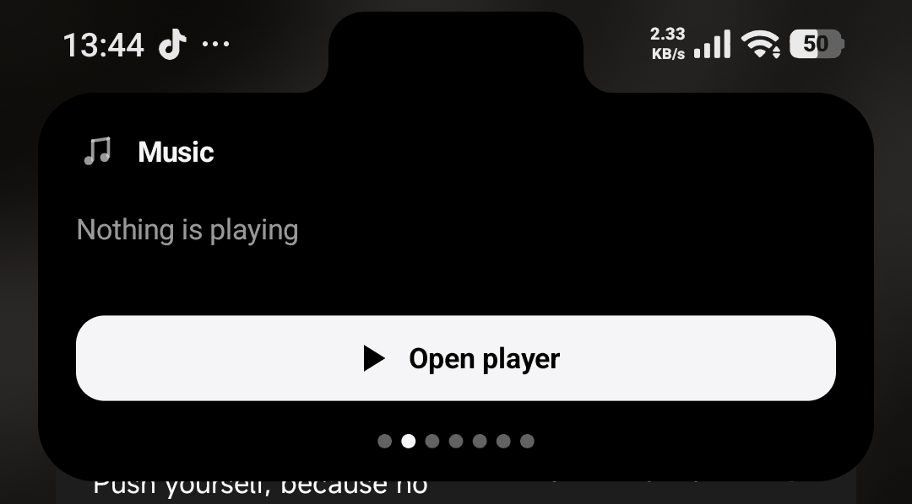
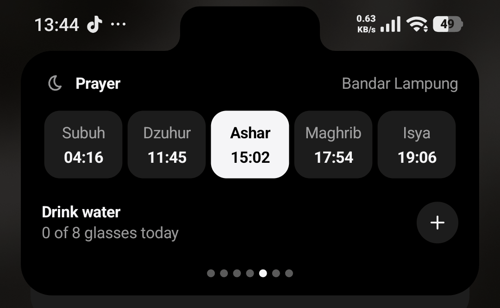
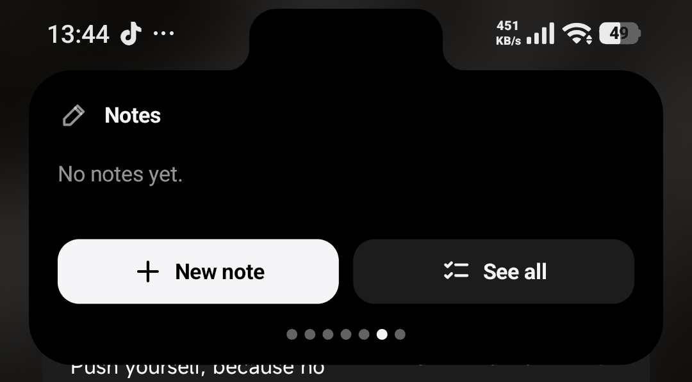

# Tepi untuk Android

Dynamic island untuk HP Android yang tidak punya island bawaan. Saudara dari [Tepi untuk Windows](https://github.com/odlaver/tepi).

**Halaman Tepi: [odlaver.github.io/tepi](https://odlaver.github.io/tepi/)**

<p>
  
  
  
</p>

Island duduk di sekitar kamera depan dan membesar saat ada yang terjadi: lagu yang diputar, pesan masuk, panggilan, unduhan, navigasi, timer, kelas berikutnya, dan waktu sholat. Ditulis dengan Kotlin tanpa pustaka tambahan selain ML Kit untuk terjemahan. Tampilan tersedia dalam bahasa Indonesia dan Inggris.

## Fitur

**Tab.** Ketuk kamera untuk membuka Beranda, lalu geser ke kiri atau kanan untuk pindah tab.

| Tab | Isi |
|---|---|
| Beranda | Sapaan, jam, kelas dan sholat berikutnya, tombol cepat |
| Musik | Cover, kontrol, progres, lirik tersinkron dari LRCLIB (cadangannya NetEase) |
| Timer | Fokus 25 atau 50 menit lalu istirahat, timer 5/10/15 menit, stopwatch dengan putaran |
| Agenda | Kelas hari ini dan tugas dari Kulia, Todoist, Notion, atau kalender iCal |
| Ibadah | Lima waktu sholat hari ini (metode Kemenag, dihitung di HP) dan hitungan minum |
| Agen | Sesi Claude Code dan agen lain di laptop, muncul setelah HP tersambung ke Tepi Windows |
| Catatan | Catatan cepat |
| Rak | Teks dan berkas yang dibagikan ke Tepi |

**Aktivitas yang muncul sendiri:** pesan masuk dengan balas cepat, panggilan, unduhan dan progres, navigasi Google Maps, timer aplikasi Jam, pengisian daya, baterai lemah, mode dering, headset, titik saat kamera atau mikrofon dipakai, serta pengingat sholat, kelas, minum, istirahat mata, dan peregangan.

**Gestur:**

| Gestur | Aksi |
|---|---|
| Ketuk kamera | Buka Beranda, ketuk lagi untuk menutup |
| Ketuk island | Buka panel aktivitas |
| Geser ke bawah | Buka panel |
| Geser ke atas | Tutup panel atau buang aktivitas |
| Geser ke samping | Pindah tab |
| Tahan | Menu cepat: timer, catatan, Mode bank, sembunyikan 1 jam, pengaturan |

Tepi juga bisa dibuka dari tile di Quick Settings dan dari pintasan saat ikon Tepi ditahan.

**Lainnya:**
- terjemahan di HP lewat ML Kit, dari menu seleksi teks;
- island tetap tampil di layar kunci, tapi hanya musik, timer, dan ibadah. Isi pesan, catatan, rak, dan agenda baru terlihat setelah HP dibuka;
- pilihan aplikasi mana saja yang notifikasinya dibaca Tepi;
- sakelar utama untuk mematikan semuanya sekaligus.

## Pasang

Unduh APK terbaru di [Releases](https://github.com/odlaver/tepi-android/releases), lalu pasang. Butuh Android 10 ke atas dengan prosesor arm64. APK ditandatangani R. Revaldo Vabiansyah; pembaruan berikutnya bisa dipasang di atasnya tanpa menghapus aplikasi.

Semua izin bisa dinyalakan dari layar pertama Tepi:

| Izin | Untuk apa |
|---|---|
| Tampil di atas aplikasi lain | Menggambar island dan mengenali aplikasi layar penuh |
| Akses notifikasi | Membaca lagu yang diputar, pesan masuk, dan notifikasi berprogres |
| Autostart dan baterai | Xiaomi, Oppo, Vivo, dan Huawei menghentikan Tepi di latar tanpa ini |
| Aksesibilitas (opsional) | Satu jendela di atas status bar supaya island bisa disentuh di sana, termasuk ketuk kamera |

Android 13 ke atas mengunci akses notifikasi dan aksesibilitas untuk aplikasi dari luar Play Store. Buka kuncinya di Info aplikasi › ⋮ › Izinkan setelan terbatas.

### Aplikasi bank

Aplikasi bank menolak terbuka selama ada layanan aksesibilitas yang tidak mereka kenal. Karena itu, saat BCA mobile, blu, wondr, BNI Mobile, BRImo, Livin', Jago, OCTO, atau Jenius dibuka, Tepi mematikan aksesibilitasnya sendiri. Island tetap jalan di bawah status bar. Untuk aplikasi lain yang menolak, tahan island lalu pilih **Mode bank**.

Android tidak mengizinkan aplikasi menyalakan aksesibilitasnya sendiri. Setelah selesai, ketuk **Aksesibilitas** di Beranda island atau di pengaturan Tepi untuk menyalakannya lagi.

## Sambungan ke laptop

Butuh Tepi untuk Windows yang punya menu **HP**. Di laptop: Tepi › Pengaturan › HP › Hubungkan HP, lalu Buat kode. Di HP: Integrasi › Laptop › **Pindai QR**, arahkan ke kode QR di laptop, lalu Sambungkan. QR juga bisa dipindai dari aplikasi kamera; tanpa Google Play services, ketik alamat dan kode 12 karakter yang muncul. Laptop dan HP harus satu Wi-Fi, dan firewall Windows perlu mengizinkan Tepi di jaringan privat.

Setelah tersambung:
- permintaan izin dari agen coding di laptop bisa dijawab dari HP, dengan sidik jari untuk Izinkan;
- pesan masuk di HP ikut tampil di Tepi laptop;
- kode verifikasi dari SMS, email, dan aplikasi bank siap disalin di laptop;
- berkas bisa dikirim dua arah. Dari HP, pilih **Kirim ke laptop** di menu Bagikan.

## Privasi

Tidak ada akun, server, atau analitik. Yang keluar dari HP hanya:

- judul dan artis lagu ke LRCLIB atau NetEase, kalau lirik online nyala;
- permintaan ke layanan yang kamu sambungkan (Kulia, Todoist, Notion, tautan iCal);
- model terjemahan ML Kit, diunduh sekali setelah kamu setujui;
- data ke Tepi di laptop, terenkripsi AES dan ditandatangani HMAC, hanya di jaringan lokal.

Layanan aksesibilitas tidak membaca isi layar. Ia hanya diberi tahu saat salah satu aplikasi bank di atas dibuka, lalu mematikan dirinya. Token dan sesi disimpan terenkripsi dengan Android Keystore. Rinciannya ada di Tepi › Tentang › Yang dibaca Tepi.

## Build sendiri

Butuh JDK 21 dan Android SDK (platform 36).

```
./gradlew assembleDebug
```

APK ada di `app/build/outputs/apk/debug/`. Untuk menandatangani dengan kunci sendiri, isi `TEPI_STORE` dan `TEPI_STORE_PASSWORD` di `~/.gradle/gradle.properties`. Tanpa itu, Gradle memakai kunci debug.

## Pustaka pihak ketiga

- [ML Kit Translate](https://developers.google.com/ml-kit/language/translation) dan Language ID, untuk terjemahan di HP.

## Lisensi

MIT. Lihat [LICENSE](LICENSE).
